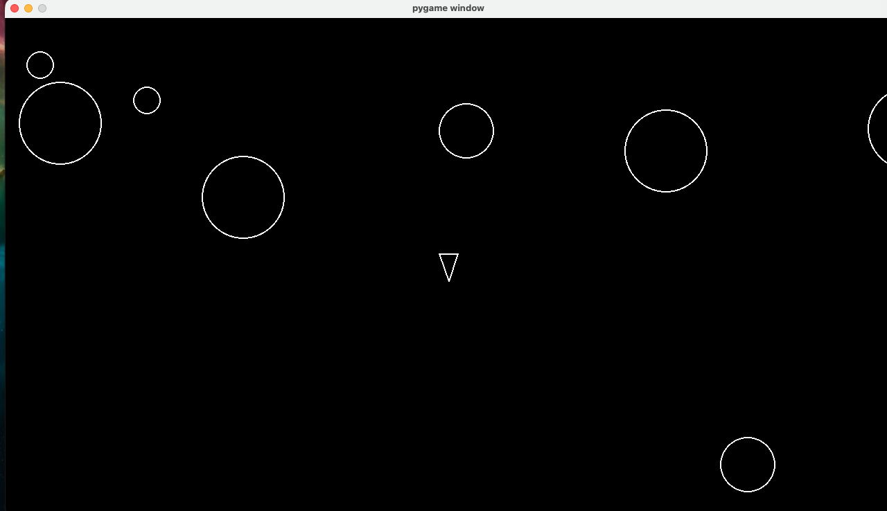

# Asteroids

A small Asteroids clone built with Python and pygame. Fly a ship, shoot the rocks, and try not to get hit.



## Requirements

- Python 3.13 or newer
- [uv](https://docs.astral.sh/uv/) for dependency management

## Setup

```bash
uv sync
```

This creates a virtual environment and installs pygame.

## Run

```bash
uv run python main.py
```

## Controls

| Key   | Action          |
| ----- | --------------- |
| W     | Thrust forward  |
| S     | Thrust backward |
| A     | Turn left       |
| D     | Turn right      |
| Space | Shoot           |

## How it works

- Asteroids drift in from the edges of the screen.
- Shooting a large asteroid splits it into two smaller ones; the smallest ones are destroyed.
- Touching an asteroid ends the game.

## Project structure

```
asteroids_game/
  main.py              # entry point and game loop
  game/
    constants.py       # screen size, speeds, radii, and other tunables
    logger.py          # writes game state and events to JSON log files
    entities/
      circleshape.py   # base sprite: position, velocity, collision check
      player.py        # the ship: movement, rotation, shooting
      asteroid.py      # asteroids and their splitting logic
      asteroidfield.py # spawns asteroids over time
      shot.py          # bullets fired by the ship
```

## Development

Formatting and linting use [ruff](https://docs.astral.sh/ruff/), wired up as a pre-commit hook so every commit stays clean.

```bash
# one-time setup
uv tool install pre-commit
pre-commit install

# run the checks by hand
pre-commit run --all-files
```

Ruff auto-fixes and formats your staged files on each commit.
